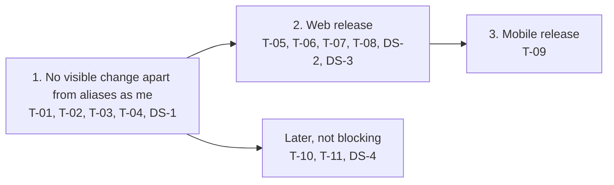

# 114. Delegation: use the mailboxes delegated to me

Date: 2026-10-20

## Status

Proposed

## Related ADRs

- [ADR-0017](./0017-email-cache-guideline.md), [ADR-0027](./0027-use-tuplekey-store-data-cache.md) — cache keys carry the account
- [ADR-0086](./0086-android-composer-draft-loss-on-background.md), [ADR-0112](./0112-web-composer-reload-snapshot.md) — composer restore (Android, web reload)
- [ADR-0092](./0092-upgrade-flutter-riverpod-3.md), [ADR-0103](./0103-urgent-exception-handling-for-riverpod-flows.md) — new state in Riverpod
- [ADR-0116](./0116-team-mailbox-switch.md) — team mailboxes in the same switcher

## Context

- Delegation ([#4977](https://github.com/linagora/tmail-flutter/issues/4977)): an owner lets a delegate read, send and organize mail in the owner's mailbox, without access to the owner's settings. This ADR is phase 1, the delegate side: see the mailboxes delegated to me and switch to one. The owner side and the link of the §5 email come later.
- Backend ([James ADR-0064](https://github.com/apache/james-project/blob/master/src/adr/0064-account-delegation.md), [tmail-backend #530](https://github.com/linagora/tmail-backend/issues/530)): each mailbox delegated to me is an extra account in my `Session.accounts`, with `isPersonal: false` and `name` = the owner's address. Standard JMAP calls with its `accountId` act on the owner's mailbox, and `Identity/get` returns the owner's identities. So switching needs no new method, only "Remove your access" needs `DelegatedAccount/get|set`. Owner-only methods refuse a delegated `accountId`: `Forward/set`, `Settings/set`, `Keystore/set`, `LongLivedToken/*` and `Delegate/*`. The Firebase methods take no `accountId` and always act on my own account. tmail-backend sends each `StateChange` of an owner to the FCM subscriptions of the owner and of every delegate with push on (`FirebasePushListener`), keyed by the owner's `accountId`.
- Today one id, `MailboxDashBoardController.accountId` (my personal account), drives the view, push and caches. Settings gets the session and the quota from the dashboard and derives its own `accountId` from `session.accountId`.
- Design: [Figma web](https://www.figma.com/design/XqLqMINlZw09BdEHI8yLb9/Teammail---1.1?node-id=12064-19139), [Figma mobile](https://www.figma.com/design/XqLqMINlZw09BdEHI8yLb9/Teammail---1.1?node-id=12712-45634).

## Decision

### Two account ids, behind a toggle

```
mine   = session.accountId                  // my personal account, the existing dashboard.accountId
active = the account picked in the switcher  // mine or a delegated account, mine by default

delegation on = session has urn:apache:james:params:jmap:delegation
             && Preferences › "Delegation" is on   // local, off by default, hidden behind the 7-tap experimental reveal like Drive was
```

- Delegation off or no delegated account: `active` = `mine` and there is no switcher, so the app works as today, apart from the cleanup of ended delegations and my aliases counting as "me". Turning the toggle off while a delegated mailbox is shown runs the normal switch back to `mine`. While a composer is open that switch is refused with a toast and the toggle stays on. Once stable, a later ticket turns the toggle on by default and removes it from the reveal.
- One mailbox is shown at a time. A delegated mailbox is never merged into my folder tree. A web reload and a mobile app restart keep the shown account (see Start on a delegated account). A sign-in still lands on `mine`, as it lands on a plain `/dashboard` today.
- An owner is shown by name and address when a name is known, otherwise by address only. The session gives only the address, so v1 shows the address.

### One source for the shown account

```dart
class ActiveAccount with EquatableMixin {
  final Session session;
  final AccountId accountId;

  ActiveAccount.personal(this.session) : accountId = session.accountId;
  ActiveAccount.delegated(this.session, this.accountId);

  AccountId get personalAccountId => session.accountId;
  bool get isDelegated => accountId != personalAccountId;
  String get ownerEmailAddress => isDelegated ? session.accounts[accountId]!.name.value : session.getOwnEmailAddressOrEmpty();
  bool supportsCapability(CapabilityIdentifier capability) => capability.isSupported(session, accountId);

  @override
  List<Object?> get props => [session, accountId];
}
```

- `ActiveAccount` is Riverpod state, bridged once into the GetX dashboard. Every reader of the shown mailbox depends on it, not on `MailboxDashBoardController`. `dashboard.accountId` keeps meaning `mine` and is never written by a switch.
- `ownerEmailAddress` is "me" in the shown mailbox: my address on `mine`, the owner's address on a delegated account. It replaces `ownEmailAddress`, `getOwnEmailAddress*` and `session.username` wherever they mean "me" in the view and the composer.
- A user can own several addresses (aliases). "Me" is shown with one address, `ownerEmailAddress`, in the avatar, in the switcher and as the sender when no identity is loaded. "Me" is matched against `ownerEmailAddresses`: `ownerEmailAddress` plus the email of every identity loaded for `active`, minus the addresses of the other accounts of the session and of my team mailboxes (`emailTeamMailBoxes`), so an identity that sends as another account's owner or as a team is not "me". `ownerEmailAddresses` is derived from `ActiveAccount` and those identities, and is `{ownerEmailAddress}` until they load. The match decides "sent by me", the addresses reply-all leaves out and the reply-all button. The "From me" chip sets `from` to `ownerEmailAddresses` (one `from` condition per address, joined by OR) and is shown selected when `from` equals that set. On `mine` this also recognizes mail to or from my aliases, which today match only the username address.
- The view checks capabilities with `supportsCapability`, since a delegated account can lack a capability that `mine` has. `supportsCapability` reads only the `accountCapabilities` of that account, never the session-level `capabilities`. `getCapabilityProperties` falls back to the session-level `capabilities` when the account does not list the capability or its entry fails to parse (`EmptyCapability`). For an account the session lists with `isPersonal: false` it no longer falls back, except for `urn:ietf:params:jmap:core`, whose limits RFC 8620 defines for the server, so a capability that account does not list returns null. `mine` and account ids the session does not list keep today's fallback. Support tests written as `getCapabilityProperties(...) != null` (e.g. `validateCalendarEventCapability`) then stay correct on a delegated account.
- Every session read rebuilds `ActiveAccount` from the new session. It keeps `accountId` while the session still lists it, otherwise it becomes `ActiveAccount.personal` (see Revocation). `ActiveAccount.delegated` is only built for an account the session lists.
- A change of signed-in user also starts from `ActiveAccount.personal`, so a later multi-account login switches sessions above `ActiveAccount` without changing its readers.

### What changes in the code base

Every reader of the dashboard `accountId` is classified: the shown mailbox moves to `ActiveAccount`, everything personal stays on `mine`. A missed reader stays on `mine`, so it can never change the owner's settings. State loaded for `active` (quota, mailbox ids, identities) is never handed to a `mine` area, so Settings loads its own quota instead of taking the dashboard's. A test lists the remaining readers of `dashboard.accountId` and fails on a new one, so new code reads `ActiveAccount.accountId` for the shown mailbox or `ActiveAccount.personalAccountId` for personal data.

| Area | Account | Why my own account does not regress |
|---|---|---|
| Mailbox view: folders, emails, search, flag, move, delete, labels, spam, quota | `active` | Same value while `active` = `mine` |
| Composer, identities, "me" in views and filters | `active`: the owner's identities and folders, reply-all leaves every address of `ownerEmailAddresses` out | Same, plus my aliases now count as "me" |
| Settings, vacation, filters, forwarding, server settings, AI Scribe, ecosystem, contact autocomplete | `mine`, and Settings is hidden while a delegated account is shown (see Settings) | Untouched, so the owner's settings are unreachable |
| Notification tap, share and `mailto` intents (mobile) | The account of the notification, `mine` for an intent: a tap while another account is shown switches to the notification's account first, then opens the email (see Sync). A share or `mailto` intent switches to `mine`, then opens the composer. A refused switch drops the tap or intent with a toast | Unchanged when `active` = `mine` and delegation is off |
| Web URL and history | Every URL of a delegated account carries `account=<accountId>` next to its mailbox and email ids, the `.eml` preview tab included. Reload, Back, a new tab and "Open in new tab" then show the same account, folder and email. A switch pushes the target's Inbox URL once it succeeds. A refused or rolled-back switch leaves the URL unchanged. Back or Forward to an entry of another account runs the normal switch (refused while a composer is open, the URL is put back). An entry whose account is no longer delegated is handled like a start (see Start on a delegated account) | Unchanged on `mine`: its URLs carry no `account`. A URL without `account` has to mean `mine` anyway (bookmarks, links and history entries from before delegation), so adding it on `mine` would only give the same page a second URL. It also keeps a reload after another user signs in on the same browser on that user's own mailbox |

### Settings

- Settings is reached from `mine` only. With `active` delegated, one rule, `canOpenSettings = !active.isDelegated`, hides every entry: "Manage account" in the avatar menu, the settings button of the mobile mailbox bar and the link of the vacation banner. The web identity-cache restore opens Settings on `mine` only.
- `/settings` opened while a delegated account is shown goes to the dashboard of that account. A page load of `/settings` carries no `account`, so it starts on `mine`.
- Settings still reads `mine` only, so an entry that a later change forgets to hide still cannot reach the owner's settings.

### Local data

- No database schema change or migration: cache keys already carry the account id (ADR-0027), so a delegated account's mailboxes and email lists are cached apart from mine.
- No received email is stored for offline reading in a delegated account: `StoreOpenedEmailInteractor` (mobile) and the new-email download run for `mine` only.
- Each mail in the send queue stays bound to the account it was written in.
- A delegated draft (composer restore on web reload and Android) is restored only when that mailbox is shown, and is removed on logout. A start runs the switch to the remembered or URL account first, then restores the snapshot of the shown account. Drafts of `mine` restore as today.
- The cleanup of ended delegations is described under Revocation.

### Sync

- Foreground WebSocket: one connection per session, kept across switches. Each `StateChange` is filtered by account: `changed[active]` refreshes the view, `changed[mine]` keeps the mobile extras (delivery state, notification removal, offline bodies), and other accounts are dropped, then caught up through `/changes` when they are opened. This is today's filter while `active` = `mine`. The connection stays bound to `mine`: `injectWebSocket` and `WebSocketController.initialize` keep one account parameter, renamed `personalAccountId` (T-03), for the capability check, the connection and the `changed[mine]` key. The shown account is not passed in. For each `StateChange` the filter reads `activeAccountProvider` and the switch state, and skips `changed[active]` while a switch runs, so a switch never reconnects.
- The 2 s debouncer merges the `changed` maps of its window per account instead of keeping only the last `StateChange`, so one account's push never hides another's. The only difference from today is that events the current debouncer drops are kept.
- FCM push and system notifications: with delegation on, `changed[mine]` and the `changed` entry of every delegated account the session lists raise notifications, so a delegate catches up with the owner's mail on time. A delegated notification names the owner, its tap switches to that account (refused while a composer is open), and its email body is not stored offline. Notification removal on read applies to it too. With delegation off, or for an account the session does not list, delegated entries are dropped. The iOS notification extension, which today shows a generic notification for them, reads each entry by account instead of the first one, and fetches a delegated entry with my own session.
- Session: with delegation on, it is also re-read on resume (at most once a minute), after "Remove your access" and on `accountNotFound`, since the server does not push session changes. Settings takes each re-read session from the dashboard, so "Delegated to me" never keeps a removed entry. With delegation off the session is read at start only, as today.

### Switching

1. Refused while a composer is open or another switch runs. The switcher stays disabled until the switch ends.
2. Input is blocked, so no action on the old list goes out with the new account. The current selection and search are saved, and `active` is set to the target.
3. Folders and the first page of emails load from cache first, then `/changes`. Identities load from the server. A modal loading dialog appears after 300 ms, stays at least 500 ms and offers Cancel (no design yet).
4. The switch ends on success, failure, cancel or a 30 s timeout, and the dialog closes. On failure, cancel or timeout `active` goes back to the previous account with its selection and search, and a toast says "Couldn't open [Owner]'s mailbox". The previous account then runs `/changes` from its loaded state, which picks up what arrived during the switch.

- A switch to `mine` (toggle off, revocation, notification tap of `mine`, intent) never rolls back to a delegated account. On failure, cancel or timeout `mine` is shown from cache with the error toast, and a pending tap or intent is dropped.
- Every view result (load more, search, opened email, refresh) carries the switch generation it was requested in. One check where view results are consumed drops it when that generation is no longer current, so a cancelled or timed-out switch never writes into a later one, even to the same account.
- `StateChange` events for the target are not applied while the switch runs. The switch ends with `/changes` from the loaded state, which picks up what arrived meanwhile.

### Start on a delegated account

- Web: the `account` of the URL, with its folder and email. Android and iOS app: the last shown account, kept per signed-in username in local storage. It is set to `mine` on sign-in and each time `mine` is shown, written after each successful switch, and removed on logout. A cold start from an intent starts on `mine`, and from a notification tap on the account of the notification, or on `mine` when delegation is off or that account is no longer listed.
- It is read once the session is loaded. If delegation is on, the session lists the account as delegated and the layout has its entry point (T-07, T-08, T-09), the app starts on it with the loading dialog of a switch, then opens the folder and email of the URL on web (the Inbox when they are gone) and the Inbox in the Android and iOS app. If that load fails, is cancelled or passes 30 s, the app starts on `mine` with the error toast.
- Otherwise (toggle off, access ended, another user signed in, no entry point yet on that layout) the app starts on `mine` with an info toast, rewrites the URL to a plain `/dashboard` on web and forgets the account in the Android and iOS app.

### Revocation and ended delegations

- The server does not push a revocation, and James keeps the session `state` fixed, so the app notices it on resume or at the first `accountNotFound`. `accountNotFound` re-reads the session at once, not throttled, with one read in flight. If the account is still listed, later `accountNotFound` errors on it do not re-read the session before the next resume.
- If the shown mailbox leaves the session, the app switches to `mine`, warns, and closes a composer open in it (counted in the warning below).
- A switch in flight to the removed account is cancelled and its late results are ignored. A switch away from it goes on and falls back to `mine` on failure.
- The removed account's cache, content files, send queue and composer snapshots under the signed-in username are deleted, even with the toggle off (on the session read at start). Data of other usernames in the shared database (ADR-0027) is never touched. If it had unsent mail or saved drafts, a warning says how many are lost, also when it was not shown. `mine` is always in the session, so it is never deleted.
- An offline start of the Android and iOS app uses the cached session and starts on the remembered account from cache. Identities and `/changes` wait for the network instead of failing the start. The other delegated accounts stay hidden from the switcher until an online session confirms them. That session then applies the rules above, and the cleanup waits for it.
- When the account list changes, WebSocket push is re-enabled, so a new delegation is live too.

### Tickets and merge order

| Id | Ticket | Depends on |
|---|---|---|
| DS-1..4 | Design system: person row + group, switcher chip + menu, stacked avatars + "Viewing ✕" chip, empty-state card. The switcher takes generic groups of items (id, name, address, avatar): my mailbox, delegated to me, and later team mailboxes | — |
| T-01 | `ActiveAccount` and the switch flow, no UI | — |
| T-02 | Classify every reader and every "me" source onto `ActiveAccount` or `mine`, view capabilities, stale view results, Settings quota, Settings entries hidden on a delegated account, composer, URL with `account`, the start on a delegated account (web URL, mobile last shown account), notification tap and intents. One test per reader and per Settings entry, plus the test on new readers | T-01 |
| T-03 | Realtime and FCM filter per account, delegated entries kept when delegation is on (the iOS notification extension included), per-account debounce and "from cache" flag on the session result | T-01 |
| T-04 | Local data: no delegated bodies, cleanup of ended delegations, composer snapshots | T-01, T-03 |
| T-05 | Loading dialog | T-01 |
| T-06 | Experimental "Delegation" toggle in Preferences, with the session re-read and revocation it turns on | T-01, T-03, T-04 |
| T-07 | Web Workplace switcher chip (#4977 §8) | T-02, T-03, T-04, T-05, T-06, DS-2 |
| T-08 | Web stand-alone avatar menu + "Viewing [Owner] ✕" banner (#4977 §9) | T-02, T-03, T-04, T-05, T-06, DS-3 |
| T-09 | Mobile app, tablet, mobile web (Figma mobile), notifications of delegated accounts and their tap | T-02, T-03, T-04, T-05, T-06, DS-1, DS-3 |
| T-10 | `DelegatedAccount/get\|set` extension + data layer | — |
| T-11 | Settings › Delegation: "Delegated to me" + "Remove your access". `/settings?type=delegation` opens Settings › Delegation when the entry is shown, otherwise the default settings page with no delegation controls and no request | T-06, T-10, DS-1, DS-4 |
| T-12 | E2E scenarios, with each release | — |

Ticket ids follow the implementation order. T-01 to T-04 run on `mine` as soon as they merge, with no change of behaviour apart from my aliases counting as "me" (T-02). The switch flow of T-01 is reached only from the entry points. The toggle (T-06) merges with its first reader, the session re-read, right before the entry points. The entry points (T-07, T-08, T-09) merge last, after T-02: without T-02, a switch would mix the two accounts in the composer, in "me" and in the quota shown in Settings. The toggle keeps them hidden from users while testers can turn them on.



T-12 ships with every stage.

## Consequences

- Main regression risk: a reader classified on the wrong account. T-02 covers each existing reader with a test, and the test on new readers makes new code pick `ActiveAccount` or `mine`.
- No database schema change or migration.
- Toggle off or no delegation: the app works as today, apart from my aliases counting as "me". The only extra work is the cleanup of ended delegations on the session read at start, which finds nothing to delete when no delegation was ever used.
- With delegation on, a delegate gets a notification for each new mail of every mailbox delegated to them.
- A revocation by the owner shows up only at the first failing request or the next resume. Giving up access with "Remove your access" re-reads the session at once.
- One mailbox at a time: a unified view of several mailboxes would need several active accounts and is out of scope.
- Team mailboxes are planned in [ADR-0116](./0116-team-mailbox-switch.md), as a scope of `mine` next to `ActiveAccount`, so no delegation ticket changes for them.

