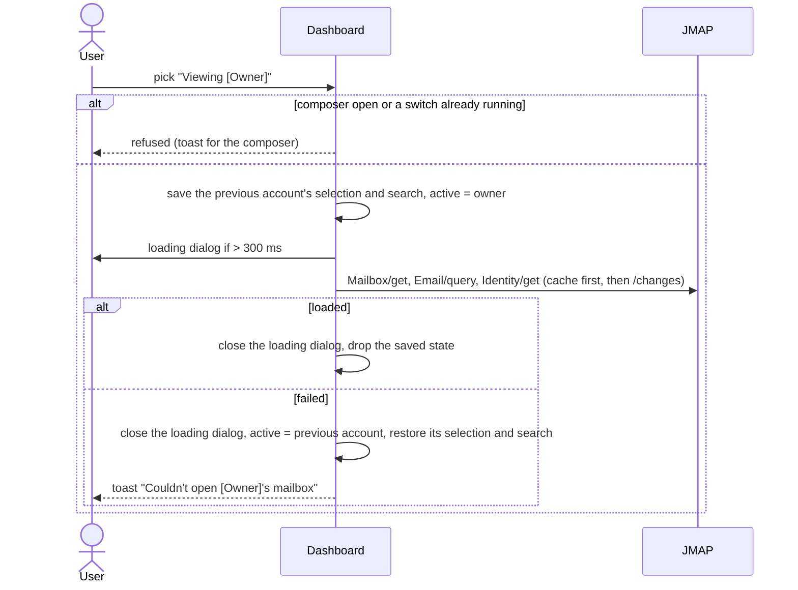
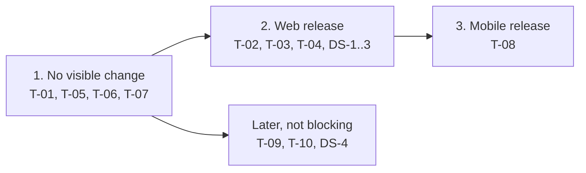

# 114. Delegation: use the mailboxes delegated to me

Date: 2026-10-20

## Status

Proposed

## Related ADRs

- [ADR-0017](./0017-email-cache-guideline.md), [ADR-0027](./0027-use-tuplekey-store-data-cache.md) — cache shown by the UI, keys carry the account
- [ADR-0092](./0092-upgrade-flutter-riverpod-3.md), [ADR-0103](./0103-urgent-exception-handling-for-riverpod-flows.md) — new state in Riverpod

## Context

- [#4977](https://github.com/linagora/tmail-flutter/issues/4977) covers both sides of delegation. The **delegate side** ships first: after sign-in, the user sees the mailboxes delegated to them and switches to one. Managing my own delegates is out of scope.
- Backend ([James ADR-0064](https://github.com/apache/james-project/blob/master/src/adr/0064-account-delegation.md), [tmail-backend #530](https://github.com/linagora/tmail-backend/issues/530)): each delegated account is in `Session.accounts` with `isPersonal: false` and `name` = owner's address. Standard JMAP calls with its `accountId` act on the owner's mailbox, and `Identity/get` returns the owner's identities, so mail is sent as the owner. Delegates are refused on `Forward/*`, `Keystore/set`, `LongLivedToken/*`, `Delegate/*` and Firebase methods.
- Switching needs no new JMAP method. Only "Remove your access" needs `DelegatedAccount/get|set` (capability `urn:apache:james:params:jmap:delegation`).
- Today `MailboxDashBoardController.accountId` (the personal account) drives the whole mailbox view, and push handlers keep only `stateChange.changed[accountId]`.
- Design: [Figma web](https://www.figma.com/design/XqLqMINlZw09BdEHI8yLb9/Teammail---1.1?node-id=12064-19139), [Figma mobile](https://www.figma.com/design/XqLqMINlZw09BdEHI8yLb9/Teammail---1.1?node-id=12712-45634).

## Decision

### Two accounts, one rule

```
mine   = session.accountId           // settings, vacation, filters, forwarding, server settings,
                                     // push registration, AI Scribe config, ecosystem
active = account picked in switcher  // mailboxes, emails, identities, quota, search, composer,
         (default: mine)             // realtime sync, "me" in views
```

- One mailbox at a time. Switching replaces `active` and reloads the mailbox view. Delegated folders are never merged into my tree.
- The switcher lists mine, then non-personal accounts with the mail capability, and is shown only when at least one non-personal account is listed.
- Sign-in, reload and restart always start on `mine`.
- `active` lives in a Riverpod notifier. One bridge pushes it into the GetX dashboard, whose listeners reload the view.

### Switching



The first switch to an account has no cache, so we propose a loading dialog (no design yet):

```
┌──────────────────────────────────────┐
│  ( JD )  Opening john.doe@domain's   │  "Opening your mailbox" when switching back
│          mailbox                     │
│  ━━━━━━━━━━━━━━━━━━━━━━━━━━━━━━━━━━  │  indeterminate progress
└──────────────────────────────────────┘
```

It is modal, appears only after 300 ms and stays at least 500 ms (no flash, no flicker), and closes once the folders and the first page of emails are shown, or when the switch fails. One switch runs at a time: the switcher is disabled from the pick until the switch ends, so no late result or delayed dialog of an older switch can overwrite a newer one.

### In a delegated mailbox

| Feature | Behaviour |
|---|---|
| Read, search, flag, move, delete, labels, spam | On the owner's mailbox |
| Compose, reply, forward | Owner's identities and folders, reply-all drops the owner |
| "me" in views, "from/to me" filters, copied folder subaddress | The owner |
| Contact autocomplete | Mine (unchanged) |
| Settings and other `mine` features | Mine, the owner's settings are unreachable |
| Storage bar | Owner's quota |
| Local data | Cache per account. No received email body is stored: `StoreOpenedEmailInteractor` (mobile only, Hive + content file) and the new-email download of the mobile sync run for `mine` only. Web keeps opened emails in memory only. Mobile send queue kept: each queued mail stays bound to its account and is never sent from `mine` |

### Notifications

```
background push (FCM, mobile)   : stateChange.changed[mine]     // unchanged
foreground realtime (WebSocket) : stateChange.changed[active]   // was: mine
```

System notifications stay for my own mailbox, so the FCM path cannot regress. For `active` ≠ `mine`, the foreground sync only refreshes the view: the mobile extras of that sync (new-email bodies kept for offline, FCM delivery state, notification removal) stay on `mine`. Tapping a notification first switches to `mine` through the normal switch (an open composer or a running switch is respected), then opens the email. Notifications for someone else's mail need their own design and link handling, so they can come later as an opt-in. The shown mailbox stays live, and my own catches up through `/changes` when I switch back.

### Session changes and revocation

- The session is re-read on app or tab resume (at most once a minute) and after "Remove your access". When its account list changes, WebSocket push is re-enabled, so a new delegation is live too.
- If the shown mailbox leaves the session, the app switches to mine and warns. A composer open in it is closed, since its draft can no longer be saved there.
- Cached data of an account that left the session is deleted (cache entries and their content files), unsent mail in its send queue included. My own account is always in the session, so it is never deleted.

### Web and mobile

The logic is shared. Differences:

| | Web | Mobile app |
|---|---|---|
| Entry point | Workplace: "Viewing [name]" chip (#4977 §8). Stand-alone: avatar menu + "Viewing [Owner] ✕" banner (#4977 §9) | Figma mobile. Tablet and mobile web layouts follow it |
| URL | Ids of a delegated mailbox stay out of the URL, history reset on switch, "Open in new tab" hidden for its emails and folders, so a reload, Back or new tab never looks them up in my account | — |
| Composer | Several floating. One written in a delegated mailbox is restored after a reload only when that mailbox is opened again. Logout and the cleanup of an account that left the session remove its snapshots too | Full-screen |
| Realtime | WebSocket on `active` | WebSocket on `active`, FCM on `mine` |
| Offline | — | Offline start uses the cached session, so the cleanup waits for the next online session |

### Tickets

| Id | Ticket | Effect on existing logic | Depends on |
|---|---|---|---|
| DS-1 | Person row + bordered group (design system) | — | — |
| DS-2 | Account switcher chip + menu (design system) | — | DS-1 |
| DS-3 | Stacked avatars + "Viewing ✕" chip (design system) | — | — |
| DS-4 | Empty-state card (design system) | — | — |
| T-01 | Active account foundation, no UI | None while `active` = `mine` | — |
| T-02 | Loading dialog | Shown only on a switch | T-01 |
| T-03 | Web Workplace switcher | Shown only with a delegation | T-02, T-05, T-06, T-07, DS-2 |
| T-04 | Web stand-alone avatar menu + banner | Shown only with a delegation | T-02, T-05, T-06, T-07, DS-3 |
| T-05 | `mine` vs `active` for every reader, composer, "me", URL and new tab, notification tap | None while `active` = `mine`, tested per reader | T-01 |
| T-06 | Session re-read, revocation, realtime on `active` (mobile sync extras stay on `mine`, push re-enabled on account change) | One throttled request on resume, for every user | T-01 |
| T-07 | Local data: no offline bodies, cleanup of ended delegations, composer snapshots | Runs only when an account disappears | T-01 |
| T-08 | Mobile app, tablet and mobile web | Shown only with a delegation | T-02, T-05, T-06, T-07, DS-1, DS-3 |
| T-09 | `DelegatedAccount/get\|set` extension + data layer | None at runtime | — |
| T-10 | Settings › Delegation: "Delegated to me" + "Remove your access" | New Settings entry | T-09, T-06, DS-1, DS-4 |
| T-11 | E2E scenarios, added with each release | — | — |

### Merge order

The entry points (T-03, T-04, T-08) are the only way into a delegated mailbox, so they merge last. Merged earlier, a user could switch while settings still follow the shown account and change the owner's. No feature flag is needed.



## Consequences

- Main regression risk: a reader left unclassified would use the owner's data as mine, or the reverse. T-05 classifies every existing reader, and new code must pick `mine` or `active`.
- Without a delegation nothing changes: no switcher, `active` = `mine`, push as today.
- The owner side later reuses the account model, Settings screen, data layer and components.

## Open points

- **Revocation is not pushed.** Until the next resume, requests on the revoked account fail. Re-reading the session on `accountNotFound` can narrow the gap, a server push of session changes would close it.
- **No display name** in the session: the owner's address is shown everywhere.
- **Settings › Delegation** appears for every user on a server with the capability, even with an empty list. Product decides whether to hide it until the owner side ships.
- **Privacy**: owner addresses and mail are never logged.
