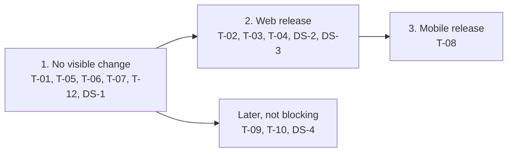

# 114. Delegation: use the mailboxes delegated to me

Date: 2026-10-20

## Status

Proposed

## Related ADRs

- [ADR-0017](./0017-email-cache-guideline.md), [ADR-0027](./0027-use-tuplekey-store-data-cache.md) — cache keys carry the account
- [ADR-0086](./0086-android-composer-draft-loss-on-background.md) — Android composer restore
- [ADR-0092](./0092-upgrade-flutter-riverpod-3.md), [ADR-0103](./0103-urgent-exception-handling-for-riverpod-flows.md) — new state in Riverpod

## Context

- [#4977](https://github.com/linagora/tmail-flutter/issues/4977) phase 1, delegate side: see the mailboxes delegated to me and switch to one. The owner side and the link of the §5 email come later.
- Backend ([James ADR-0064](https://github.com/apache/james-project/blob/master/src/adr/0064-account-delegation.md), [tmail-backend #530](https://github.com/linagora/tmail-backend/issues/530)): each delegated account is in `Session.accounts` with `isPersonal: false` and `name` = owner's address. Standard JMAP calls with its `accountId` act on the owner's mailbox, and `Identity/get` returns the owner's identities. Delegates are refused on `Forward/*`, `Keystore/set`, `LongLivedToken/*`, `Delegate/*` and Firebase methods. Switching needs no new method, only "Remove your access" needs `DelegatedAccount/get|set`.
- Today one id, `MailboxDashBoardController.accountId` (the personal account), drives the view, settings, push and caches.
- Design: [Figma web](https://www.figma.com/design/XqLqMINlZw09BdEHI8yLb9/Teammail---1.1?node-id=12064-19139), [Figma mobile](https://www.figma.com/design/XqLqMINlZw09BdEHI8yLb9/Teammail---1.1?node-id=12712-45634).

## Decision

### Two account ids, behind a toggle

```
mine   = session.accountId                // dashboard.accountId, meaning unchanged
active = account picked in the switcher   // new dashboard.activeAccountId, default mine

delegation on = session has urn:apache:james:params:jmap:delegation
             && Preferences › "Delegation"   // local, default off, hidden behind the 7-tap experimental reveal like Drive was
```

- Toggle off or no delegated account: `active` = `mine` and no switcher, so the app is exactly today's. Turning it off while a delegated mailbox is shown runs the normal switch back to `mine`: while a composer is open it is refused with a toast and the toggle stays on. Once stable, the toggle defaults to on and leaves the reveal.
- One mailbox at a time, never merged into my tree. Sign-in, reload and restart start on `mine`.
- `active` lives in a Riverpod notifier, bridged once into the GetX dashboard.
- An owner is shown by name and address when a name is known, otherwise by address only (the session gives only the address).

### What changes in the code base

Every reader of `accountId` is classified: the shown mailbox moves to `activeAccountId`, everything personal stays on `accountId`. A reader that is missed stays on `mine`, so it can never change the owner's settings.

| Area | With delegation | Why my own account does not regress |
|---|---|---|
| Mailbox view: folders, emails, search, flag, move, delete, labels, spam, quota | `active` | Same value while `active` = `mine` |
| Composer, identities, "me" in views and filters | `active`: owner's identities and folders, reply-all drops the owner | Same |
| Settings, vacation, filters, forwarding, server settings, AI Scribe, ecosystem, contact autocomplete | `mine` | Untouched, so the owner's settings are unreachable |
| FCM push, system notifications | `changed[mine]` | Untouched |
| Foreground WebSocket | One connection per session, kept across switches. `changed[active]` refreshes the view, `changed[mine]` keeps the mobile extras (delivery state, notification removal, offline bodies). Other accounts are dropped and catch up through `/changes` | Same filter while `active` = `mine` |
| Notification tap | With `active` ≠ `mine`, switch to `mine` first, then open the email. A refused switch drops the tap with a toast | Unchanged when `active` = `mine` |
| Caches | Per account. No email body is stored for a delegated account: `StoreOpenedEmailInteractor` (mobile) and the new-email download run for `mine` only. Each mail in the send queue stays bound to its account | Keys already carry the account |
| Web URL and history | Delegated ids stay out of the URL, history is reset on switch, "Open in new tab" is hidden in a delegated mailbox | Unchanged on `mine` |
| Composer restore (web reload, Android) | A delegated draft is restored only when that mailbox is opened again, and is removed on logout | Drafts of `mine` restore as today |
| Session | Also re-read on resume (at most once a minute), after "Remove your access" and on `accountNotFound` | One throttled request on resume, the only change every user gets |

### Switching

- Refused while a composer is open or another switch runs: the switcher stays disabled until the switch ends, so no late result can overwrite a newer one.
- Saves the previous selection and search, sets `active`, then loads folders, the first page of emails and identities (cache first, then `/changes`).
- A modal loading dialog appears after 300 ms, stays at least 500 ms and closes when the switch ends: success, failure or cancel (no design yet).
- On failure `active` goes back to the previous account with its selection and search, and a toast says "Couldn't open [Owner]'s mailbox".
- `StateChange` events for the target are not applied while the switch runs. The switch ends with `/changes` from the loaded state, which picks up what arrived meanwhile.

### Revocation and ended delegations

- Noticed on resume or at the first `accountNotFound`, since the server does not push it and James keeps the session `state` fixed. `accountNotFound` re-reads the session at once, not throttled, with one read in flight. If the account is still listed, it is not checked again before the next resume.
- If the shown mailbox leaves the session, the app switches to `mine`, warns, and closes a composer open in it.
- A switch in flight to the removed account is cancelled and its late results are ignored. A switch away from it goes on and falls back to `mine` on failure.
- The removed account's cache, content files, send queue and composer snapshots are deleted, also with the toggle off. On mobile an offline start waits for the next online session. `mine` is always in the session, so it is never deleted.
- When the account list changes, WebSocket push is re-enabled, so a new delegation is live too.

### Tickets and merge order

| Id | Ticket | Depends on |
|---|---|---|
| DS-1..4 | Design system: person row + group, switcher chip + menu, stacked avatars + "Viewing ✕" chip, empty-state card | — |
| T-01 | `mine` / `active` foundation, no UI | — |
| T-02 | Loading dialog | T-01 |
| T-03 | Web Workplace switcher chip (#4977 §8) | T-02, T-05, T-06, T-07, T-12, DS-2 |
| T-04 | Web stand-alone avatar menu + "Viewing [Owner] ✕" banner (#4977 §9) | T-02, T-05, T-06, T-07, T-12, DS-3 |
| T-05 | Classify every reader (table above), composer, URL, notification tap, one test per reader | T-01 |
| T-06 | Session re-read, revocation, realtime filter | T-01 |
| T-07 | Local data: no delegated bodies, cleanup of ended delegations, composer snapshots | T-01 |
| T-08 | Mobile app, tablet, mobile web (Figma mobile) | T-02, T-05, T-06, T-07, T-12, DS-1, DS-3 |
| T-09 | `DelegatedAccount/get\|set` extension + data layer | — |
| T-10 | Settings › Delegation: "Delegated to me" + "Remove your access" | T-06, T-09, T-12, DS-1, DS-4 |
| T-11 | E2E scenarios, with each release | — |
| T-12 | Experimental "Delegation" toggle in Preferences | — |

The entry points (T-03, T-04, T-08) merge last, after T-05: without T-05, a switch would let settings follow the owner's account. The toggle keeps them hidden from users while testers can turn them on.



## Consequences

- Main regression risk: a reader classified on the wrong account. T-05 covers each existing reader with a test, and new code must pick `mine` or `active`.
- Toggle off or no delegation: the mailbox view, settings and push work as today. Only the throttled session re-read on resume and the cleanup of ended delegations run.
- A revocation shows up only at the first failing request or the next resume.
