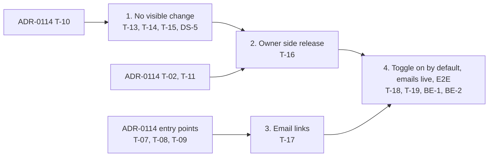

# 115. Delegation: manage who can use my mailbox

Date: 2026-10-20

## Status

Proposed

## Related ADRs

- [ADR-0114](./0114-delegated-mailbox-access.md) — phase 1, delegate side: `mine` / `active`, the delegation toggle, switching, revocation, Settings › Delegation with "Delegated to me". This ADR merges after it.
- [ADR-0092](./0092-upgrade-flutter-riverpod-3.md), [ADR-0103](./0103-urgent-exception-handling-for-riverpod-flows.md) — new state in Riverpod

## Context

- [#4977](https://github.com/linagora/tmail-flutter/issues/4977) phase 2, owner side: list my delegates (§1), add (§2) and remove (§3) them, and the pages the delegation emails link to (§5, §7). Archives (§4) is dropped: the backend keeps no history ([backend comment](https://github.com/linagora/tmail-flutter/issues/4977#issuecomment-6166025224)).
- Backend ([James delegation spec](https://github.com/apache/james-project/blob/master/server/protocols/jmap-rfc-8621/doc/specs/spec/mail/delegation.mdown) and its `Delegate/set` implementation): `Delegate/get` returns `{ id, username }` only, no name and no date. `Delegate/set` creates and destroys, no update. No `state`, so no `/changes` and no push for the list. An unknown user gets `notCreated` with `invalidArguments`, creating an existing delegate is a no-op, and destroying an id that no longer exists answers `destroyed`. Every delegation method answers `forbidden` on a delegated account.
- The backend will send the §5 email (to the delegate, on add, BE-1) and the §7 email (to the owner, when a delegate gives up access, BE-2). The app only owns the pages their buttons open.

## Decision

### Calls

```
accountId = mine (Settings' own session.accountId)   // never ActiveAccount (ADR-0114)

delegates = Delegate/get(accountId)              // on tab open, after each add or remove, on retry
add(addresses)   → one request: Delegate/set create (all addresses), then Delegate/get
remove(delegate) → one request: Delegate/set destroy [id], then Delegate/get
```

- Settings › Delegation gets two tabs: **My delegates** (default, #4977 §1) and **Delegated to me** (ADR-0114 T-11, unchanged). It follows the ADR-0114 toggle: shown only with the delegation capability and the toggle on.
- A delegate is shown by name and address when a name is known, otherwise by address only. The backend gives only the address, and there is no per-row contact lookup, so v1 shows the address.

### What changes in the code base

| Area | Change | Why my mailbox and the delegate side do not regress |
|---|---|---|
| Settings menu | "Delegation" entry with two tabs | Hidden without the capability or with the toggle off. Other entries untouched |
| Delegation requests | `Delegate/get\|set` on Settings' own `accountId` | Never `ActiveAccount`, so a delegate never reaches the owner's list (the server also answers `forbidden`) |
| Local data | None: the delegate list is not cached, it is read from the server each time | No schema change or migration |
| Add dialog autocomplete | Existing contact suggestions and chips, minus my own address (from the session, not the dashboard's "me") and the current delegates | Composer autocomplete untouched |
| Dashboard start, sign-in, settings route | Reads `?account=` once, keeps an email link across sign-in. `type=delegation` is refused while the entry is hidden (ADR-0114 T-11) | Without these links nothing runs |
| Mailbox view, push, caches | Untouched | — |
| Delegate's running app | Loses access at once on the server and follows the ADR-0114 revocation rules | Already covered by ADR-0114 |

### My delegates tab

- States: loading, error with Retry, empty ("No one has access yet" + **+ Add**), list ("Who has access to me", a trash icon per row, then **+ Add**).
- Only the latest read updates the tab, so a slow earlier read never overwrites a newer list.
- Add and remove send `Delegate/set` and `Delegate/get` in one request, and JMAP answers each method on its own:
  - `Delegate/set` succeeded but `Delegate/get` failed: the result toast is shown and the list is marked stale with Retry. Retry only re-reads, the change is never sent again.
  - The whole request failed: the outcome is unknown, so the list stays as it was with an error toast. Sending again is safe, since a repeated add or remove is a no-op.
- No realtime: a change from another device or by the delegate shows at the next open. Both stale actions are safe: a stale add is a no-op and a stale remove counts as removed.

### Add delegates

- Contacts autocomplete with chips, several at once. My own address and current delegates are left out and refused when typed. Addresses that are not users of this server are not filtered out by the app: the server rejects them and their chip shows the error.
- **Next** is enabled once one valid address is picked. The confirmation step lists the chosen people with **Add**, and Back to edit them.
- One `Delegate/set` for all addresses. While it runs, **Add** is disabled and repeat taps are ignored, so a double tap sends one request. The dialog cannot be dismissed either (Cancel, Escape, Back).
- All created: the dialog closes, the list refreshes, toast "[Delegate] has been added" (or "[n] delegates have been added").
- Some or all rejected: the created chips leave the field and the "has been added" toast names them (no toast when nothing was created), the list refreshes, and the dialog goes back to the chips step with the rejected chips and their error. **Next** stays disabled until they are removed.
- Request failed: every chip stays, error toast.

### Remove a delegate

- "Remove delegate access?" modal with the delegate's card, **Cancel** and **Remove access** (destructive). While the request runs, **Remove access** is disabled, repeat taps are ignored and the modal cannot be dismissed. No "Delegated N days ago" line: the backend keeps no creation date.
- Success: the row leaves, toast "[Delegate] has been removed", empty state after the last one. A stale id is answered `destroyed`, so it counts as removed. Any failure keeps the row and shows an error toast.

### Links in the delegation emails

| Email | Button | Link |
|---|---|---|
| §5, to the delegate | Open [Owner]'s mailbox → | `/dashboard?account=<owner accountId>` |
| §7, to the owner | Review your delegates → | `/settings?type=delegation` (existing route, `delegation` value added with the Delegation entry) |

- `account` is the owner's account id, a hash of the username, so the address itself is not in the URL. It is read once after the session loads (after sign-in when needed) and removed from the URL right away, so reload, Back and a new tab still start on `mine`. When sign-in is needed, each email link (`?account=` and `type=delegation`) is kept in session storage before the login redirect and used once after the session loads, since login today lands on a plain `/dashboard`.
- Toggle on and the account listed as delegated: the normal ADR-0114 switch from `mine`. A refused switch (restored composer open) drops the link with a toast. Otherwise the app stays on `mine` with an info toast (access ended, not granted yet, or toggle off).
- `type=delegation` while the Delegation entry is hidden (no capability, toggle off) opens the default settings page with no request (ADR-0114 T-11): today the settings route opens any page named in the URL.
- The mobile apps have no https app links, so both buttons open the web app (mobile web).
- The backend needs this format and the app's public URL for its templates (BE-1, BE-2).

### Tickets and merge order

| Id | Ticket | Depends on |
|---|---|---|
| DS-5 | Segmented tabs (design system) | — |
| T-13 | `Delegate/get\|set` in the delegation extension + data layer | ADR-0114 T-10 |
| T-14 | Add delegates dialog | T-13, DS-1 |
| T-15 | Remove delegate dialog | T-13, DS-1 |
| T-16 | Tabs + "My delegates" list | T-13, T-14, T-15, DS-1, DS-4, DS-5, ADR-0114 T-02, T-11 |
| T-17 | Email links: `?account=` on the dashboard, links kept across sign-in | ADR-0114 T-01, T-02, T-03, T-04, T-06, T-07, T-08, T-09 |
| T-18 | E2E scenarios, owner side | T-13..T-17 |
| T-19 | Delegation toggle on by default, out of the experimental reveal | T-16, ADR-0114 T-07, T-08, T-09, T-11 |
| BE-1 | tmail-backend: §5 email to the delegate on add, with the link above | T-16, T-17, T-19 |
| BE-2 | tmail-backend: §7 email to the owner when a delegate gives up access | T-16, T-17, T-19 |

Ticket ids continue ADR-0114 in implementation order. T-16 is the only way into the owner side, so it merges after T-13, T-14 and T-15. T-17 merges after every ADR-0114 entry point (web and mobile), so a link never opens a delegated mailbox on a layout without the switcher. The emails go live after the app pages they open, once T-19 turns the toggle on by default.



## Consequences

- No database schema change or migration: the delegate list is not cached.
- The mailbox view is untouched. Outside Settings, only the email links of T-17 are new (`?account=` and keeping a link across sign-in), and they do nothing without a link.
- The list can be stale until the next open, which is safe since both stale actions are.
- A removed delegate's switcher updates at their next resume or first failing request, not at once (#4977 §3 asks for at once): the server does not push session changes.
- Without the capability, or with the toggle off, nothing changes: no Delegation entry, no new request. A delegation link then only shows an info toast or the default settings page.
